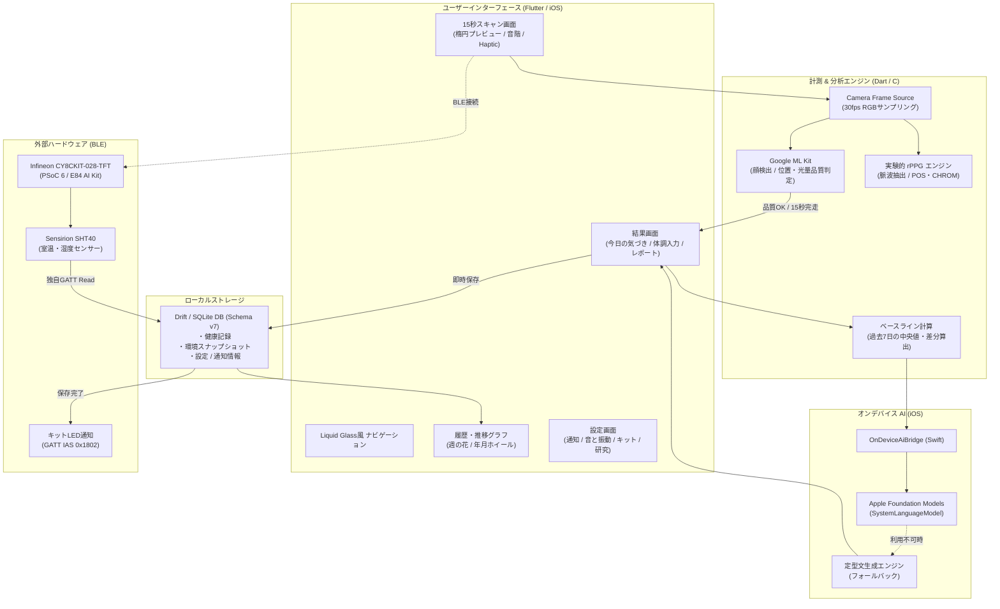

# あさかお (Asakao) — 15秒健康チェック (os_2604)

[](https://youtu.be/XgNAn_zmHVs)

> **毎朝15秒、顔をカメラで撮影して記録を残し、過去の自分との差をオフラインAIが説明する健康セルフチェックアプリ。**  
> ※ 本アプリは日常のセルフチェックと変化の振り返りを目的とした検証用MVPであり、**病気の診断・治療判断を目的とする医療機器ではありません**。

---

## 目次

1. [プロダクト概要](#プロダクト概要)
   - [背景・解決する課題](#背景解決する課題)
   - [コアコンセプト](#コアコンセプト)
   - [誠実な設計思想 (Healthcare Integrity)](#誠実な設計思想-healthcare-integrity)
2. [主要機能](#主要機能)
   - [1. 15秒カメラ健康スキャン & 品質判定](#1-15秒カメラ健康スキャン--品質判定)
   - [2. 習慣化を支える「あさかお」体験](#2-習慣化を支えるあさかお体験)
   - [3. 完全オンデバイスAIによる振り返りレポート](#3-完全オンデバイスaiによる振り返りレポート)
   - [4. Infineon E84 AI Kit 連携 (LED & 温湿度環境)](#4-infineon-e84-ai-kit-連携-led--温湿度環境)
   - [5. プライバシーファースト & 端末内完結](#5-プライバシーファースト--端末内完結)
3. [システム構成・アーキテクチャ](#システム構成アーキテクチャ)
4. [採用技術・使用パッケージ](#採用技術使用パッケージ)
   - [採用技術一覧](#採用技術一覧)
   - [使用パッケージ一覧 (pubspec.yaml)](#使用パッケージ一覧-pubspecyaml)
5. [ハードウェア仕様 (Infineon CY8CKIT-028-TFT)](#ハードウェア仕様-infineon-cy8ckit-028-tft)
6. [セットアップ & 起動手順](#セットアップ--起動手順)
   - [動作環境](#動作環境)
   - [Flutterアプリのビルド](#flutterアプリのビルド)
   - [E84ファームウェアのビルド・書き込み](#e84ファームウェアのビルド書き込み)
7. [検証・テスト実績](#検証テスト実績)
8. [免責事項・ライセンス](#免責事項ライセンス)

---

## プロダクト概要

### 背景・解決する課題

日々の健康管理や体調記録は重要ですが、毎朝血圧計や体温計を引っ張り出して入力し続けるのは手間がかかり、三日坊主になりがちです。一方で、既存のスマートヘルスアプリの多くはクラウド同期が前提であり、機微な顔画像や生体情報が外部サーバーへ送信されるプライバシー上の懸念があります。

また、カメラ画像から「体温」や「血圧」を推測できると偽るアプリも散見されますが、通常のRGBカメラでこれらを正確に測ることは医学的に困難です。

### コアコンセプト

**「あさかお」** は、毎朝わずか **「15秒」**、スマートフォンに顔を合わせるだけで完結する朝のセルフチェックアプリです。

1. **最短15秒の手軽さ**：顔位置と光量が揃ったら自動で15秒カウントダウン。心地よい音階が毎日の計測をリズミカルに演出します。
2. **咲く花で習慣化**：チェックを完了するごとに画面内の「あさかお（朝顔）」が美しく開花。1週間の継続が花束のように可視化されます。
3. **過去の自分との比較**：直近7日間の自分の中央値と比較し、「昨日に比べてどうか」をオフラインAIが客観的に振り返ります。
4. **スマートIoT連携**：Infineon製マイコンキットと連携し、計測完了をLEDで通知するとともに、部屋の室温・湿度を自動記録します。

### 誠実な設計思想 (Healthcare Integrity)

- **画像の永続化ゼロ**：カメラフレームは端末のメモリ内でのみ解析し、静止画・動画は一切保存せず破棄します。外部送信も行いません。
- **測れないものは「未測定」**：通常のRGBカメラで測定不可能な体温等は絶対に捏造せず、未測定（null）または外部体温計の手入力（出典明示）とします。
- **中断の厳密判定**：計測中に顔が外れたりアプリを離脱した場合は「中断」とし、不完全なデータを記録に残しません。
- **データ先行保存**：計測終了直後に生データをローカルDBへ保存。AIレポート生成が万一失敗しても、ユーザーの大切な測定記録を失いません。

---

## 主要機能

### 1. 15秒カメラ健康スキャン & 品質判定

- **ML Kit 顔追従 & ガイド**: Google ML Kit Face Detectionを用い、顔の有無・画面内位置・顔の向き・光量をリアルタイム判定。「中央に寄せてください」「少し暗いようです」などの具体的ガイドを表示します。
- **厳密な15秒計測**: ガイド条件が整ってから計測を開始。準備時間やAI生成時間は計測時間に含めず、純粋な15秒間の生体データをサンプリングします。
- **音と触覚のフィードバック**: 計測中は1秒ごとに音階（C major 2オクターブ、マリンバ／オルゴール／琴など7種類の楽器から選択可能）が鳴り、終了時には心地よいHaptic振動でお知らせします。
- **実験的rPPG心拍推定**: RGBフレームの時系列変化から脈波を抽出するrPPG（POS/CHROM法）を実装。設定で「研究モード」を有効化すると顔色特徴量もあわせて記録します（品質不足時は数値を非表示とし、診断目的ではないことを明記）。

### 2. 習慣化を支える「あさかお」体験

- **開花アニメーション & 週の花**: 今日の計測を完了すると、つぼみが開花するアニメーションが再生されます。直近1週間の実施状況がカレンダー上に花として咲き並びます。
- **あさかおマスコット**: 体調やステータスに応じて表情を変えるマスコットキャラクター（ふつう、うれしい、こまった、いそがしい、しおれ）。
- **推移グラフ & 年月ホイールピッカー**: 過去の体調や推定心拍数の推移を「1週間」「選択期間」で切り替えてグラフ表示。年月ホイールで過去の任意の月にジャンプ可能です。
- **今日の気づきカード**: 直近7日間の自己申告体調の中央値と本日の体調を比較し、「いつもより高め／同じ／低め」の差を分かりやすく提示します。

### 3. 完全オンデバイスAIによる振り返りレポート

- **Apple Foundation Models 連携 (iOS)**: クラウドAPIを一切使わず、iOS端末内のローカル生成AI（SystemLanguageModel）を活用。過去7日間の推移と本日の数値をまとめた振り返り文をローカルで生成します。
- **ハルシネーション（幻覚）防止**: AIには記録された数値と差分の要約のみを指示し、病名の創作や体温の捏造、医学的な緊急判定を行わせないガードレールを設計しています。
- **安全な定型文フォールバック**: AI非対応機種、OS設定でAIが無効、モデルダウンロード中、機内モード、生成タイムアウト時でも、即座にルールベースの定型レポートへフォールバック。画面が止まることなく結果を確認できます。

### 4. Infineon E84 AI Kit 連携 (LED & 温湿度環境)

BLE（Bluetooth Low Energy）を通じて、**Infineon CY8CKIT-028-TFT** と連携します。

- **LED達成通知 (Immediate Alert Service)**: 計測が正常に保存されると、マイコン側のLEDが点灯。手元のデバイスでも朝の記録完了を実感できます。
- **SHT40 高精度温湿度モニタリング**: キットに搭載されたSensirion SHT40センサーから、独自GATT Read特性（20バイトパケット）を介して室温・相対湿度を定期取得。計測終了時の部屋の環境スナップショットを健康記録と紐付けて保存し、部屋の寒さ・乾燥と体調の相関を振り返ることができます。

### 5. プライバシーファースト & 端末内完結

- **完全オフライン動作**: 初回セットアップ完了後は、機内モード（Wi-Fi OFF、モバイル通信 OFF）でもすべての計測・保存・レポート・履歴確認が動作します。
- **ローカルSQLite (Drift)**: データベースは端末内のSQLite（Drift）で安全に管理。
- **データ主権**: 履歴画面からの1件ずつのスワイプ削除、および設定画面からの全記録一括削除機能を標準提供します。

---

## システム構成・アーキテクチャ



---

## 採用技術・使用パッケージ

### 採用技術一覧

| レイヤー | 技術 / パッケージ | 用途・選定理由 |
|---|---|---|
| **フレームワーク** | **Flutter 3.47.7** / **Dart 3.13.5** | クロスプラットフォームUI、高品位なアニメーション |
| **ネイティブ (iOS)** | **Swift** / **SwiftUI** | Apple Foundation Models 連携、Liquid Glassタブバー、低遅延音声 |
| **カメラ・顔認識** | `camera: ^0.12.1`<br>`google_mlkit_face_detection: ^0.15.1` | リアルタイムフレーム取得、顔検出・追従、顔向き・光量判定 |
| **ローカルAI** | **Apple Foundation Models** (Swift) | iOS完全端末内LLMによるセルフチェック要約文生成 |
| **データベース** | `drift: ^2.35.1`<br>`drift_flutter: ^0.3.1` (SQLite) | 型安全なローカル永続化、自動マイグレーション (Schema v7) |
| **BLE通信** | `flutter_reactive_ble: 5.6.0` | Infineon E84 キットとのGATT通信 (LED制御 / SHT40温湿度取得) |
| **通知** | `flutter_local_notifications: ^22.3.2` | 毎朝のセルフチェックを促すローカルリマインダー |
| **デザイン・音声** | 自作SVG開花描画、Zen Maru Gothic、Noto Sans JP、7種楽器音階 | 朝の習慣化を促す温かみのあるオーディオ・ビジュアル |
| **ハードウェア** | **Infineon CY8CKIT-028-TFT** (E84 AI Kit) | PSoC 6 マイコン、FreeRTOS、Sensirion SHT40 センサー |

### 使用パッケージ一覧 (pubspec.yaml)

#### アプリ本体 (`dependencies`)
| パッケージ名 | バージョン | 主な役割・用途 |
|---|---|---|
| **`camera`** | `^0.12.1` | **カメラ映像のリアルタイム取得**<br>前面カメラから30fpsのRGBフレームをメモリ上に取得し、15秒間の健康スキャンを実施（画像は保存せず即時破棄） |
| **`google_mlkit_face_detection`** | `^0.15.1` | **オンデバイス顔検出・品質判定**<br>端末内で顔の位置・向き・サイズ・明るさを判定し、枠内に正しく顔が収まっているかをリアルタイムにガイド |
| **`drift`**<br>**`drift_flutter`** | `^2.35.1`<br>`^0.3.1` | **型安全なローカルSQLiteデータベース**<br>計測データ、体調、外部体温、部屋の温湿度スナップショット、設定を完全ローカル永続化（Schema v7） |
| **`flutter_reactive_ble`** | `5.6.0` | **BLE (Bluetooth Low Energy) 通信**<br>Infineon E84 AI Kit と連携。計測完了時のLED点灯通知（IAS `0x1802`）と、SHT40センサーからの室温・湿度パケット取得を担当 |
| **`flutter_local_notifications`** | `^22.3.2` | **毎朝のリマインダー通知**<br>朝の決まった時刻にローカル通知を発行。通知タップから直接計測画面を自動起動する動線を提供 |
| **`timezone`**<br>**`flutter_timezone`** | `^0.11.2`<br>`^5.1.1` | **タイムゾーン管理**<br>端末のローカルタイムゾーンを正確に取得し、毎朝のリピート通知時刻を正しく計算 |
| **`flutter_localizations`** | (SDK同梱) | **日本語UIローカライズ**<br>日付ピッカーや標準ウィジェットの日本語表示対応 |

#### 開発・検証用 (`dev_dependencies`)
| パッケージ名 | バージョン | 用途 |
|---|---|---|
| **`drift_dev`**<br>**`build_runner`** | `^2.35.1`<br>`^2.16.1` | Drift のDBテーブルやスキーマコード（`app_database.g.dart`）の自動生成 |
| **`flutter_test`**<br>**`test`** | (SDK同梱)<br>`^1.31.1` | 462件の自動テスト（単体・Widget・統合フロー）の実行フレームワーク |
| **`fake_async`** | `^1.3.3` | 15秒計測タイマーやBLEタイムアウト等の非同期・時間経過ロジックの高速テスト |
| **`camera_platform_interface`** | `^2.15.0` | テスト環境でのカメラフレーム供給モックの実装 |
| **`flutter_lints`** | `^6.0.0` | コード品質を保つ公式静的解析ルール（`flutter analyze` 指摘0件を維持） |

#### 💡 パッケージを使わず独自実装・ネイティブ連携したポイント
- **オンデバイス生成AI (Apple Foundation Models)**: 外部パッケージを介さず、Swiftの `MethodChannel` (`OnDeviceAiBridge`) でiOS標準のローカルLLMを直接呼び出し。
- **推移グラフ (1週間 / 選択期間)**: サードパーティのチャートパッケージを追加せず、Flutter標準の描画機能で体調棒グラフ・心拍折れ線を軽量・高パフォーマンスに自作。
- **朝顔の開花演出**: ベクターパスによる開花アニメーション（`asakao_flower.dart`）を独自実装。

---

## ハードウェア仕様 (Infineon CY8CKIT-028-TFT)

アプリは Infineon CY8CKIT-028-TFT (E84) と BLE 接続して連動動作します。

### 1. LED通知 (Immediate Alert Service)
- **サービスUUID**: `0x1802` (IAS)
- **キャラクタリスティックUUID**: `0x2A06` (Alert Level)
- **仕様**: 計測完了・保存成功時に `[0x02]` (High Alert) を送信してキットのUSER_LEDを点灯、消灯時に `[0x00]` (No Alert) を送信。

### 2. 環境モニタリング (SHT40 室温・相対湿度)
- **サービスUUID**: `3c1d0001-8e4b-4b1c-9a62-6d485a7e9010`
- **キャラクタリスティックUUID**: `3c1d0002-8e4b-4b1c-9a62-6d485a7e9010` (Read専用)
- **パケット構造 (20 bytes Little Endian)**:
  - `[0]`: プロトコルバージョン (`0x01`)
  - `[1]`: 状態コード (`0x00`: 正常, `0x01`: 初期化中, `0x02`: センサー異常, `0x03`: 範囲外)
  - `[2..5]`: シーケンス番号 (`uint32`)
  - `[6..9]`: サンプル鮮度ミリ秒 (`uint32`)
  - `[10..13]`: 室温 (`int32`, 1/1000 ℃単位)
  - `[14..17]`: 相対湿度 (`int32`, 1/1000 %単位)
  - `[18..19]`: 予約 (`0x0000`)

---

## セットアップ & 起動手順

### 動作環境
- **開発マシン**: macOS (Apple Silicon 推奨)
- **Flutter**: 3.47.7 stable (Dart 3.13.5)
- **Xcode**: 16 / 26 / 27 (iOS SDK)
- **実機検証対象**: iPhone 17 (iOS 27.0.1) / iPhone 15 (iOS 26.6.2)
- **ハードウェア**: Infineon CY8CKIT-028-TFT + Sensirion SHT40

### Flutterアプリのビルド

1. **依存パッケージの取得とコード生成**:
   ```sh
   flutter pub get
   dart run build_runner build --delete-conflicting-outputs
   ```

2. **iOS 署名設定**:
   ローカル開発用の署名設定を `ios/Flutter/LocalSigning.xcconfig` に配置します（Git管理外）。
   ```xcconfig
   DEVELOPMENT_TEAM = <YOUR_TEAM_ID>
   CODE_SIGN_IDENTITY = Apple Development
   ```

3. **ビルド & 実機インストール**:
   ```sh
   flutter run -d <DEVICE_ID> --release
   ```

### E84ファームウェアのビルド・書き込み

ファームウェアの詳細手順は [firmware/e84/README.md](firmware/e84/README.md) および [firmware/e84/environment/README.md](firmware/e84/environment/README.md) を参照してください。

```sh
# ModusToolbox環境でプロジェクトにパッチ適用とビルド
python3 firmware/e84/environment/apply.py /path/to/E84EnvironmentDemo
make -C /path/to/E84EnvironmentDemo build TOOLCHAIN=GCC_ARM CY_COMPILER_PATH=/path/to/gcc
# KitProg3でUSB接続し書き込み
make -C /path/to/E84EnvironmentDemo program TOOLCHAIN=GCC_ARM CY_COMPILER_PATH=/path/to/gcc
```

---

## 検証・テスト実績

本プロジェクトでは、医療・ヘルスケアに関わる誠実な挙動を保証するため、厳格な品質検証を実施しています。

- **静的解析**: `flutter analyze` 指摘 **0件**
- **自動テスト**: **462件** のUnit / Widget / Flowテスト 全件合格 (`flutter test`)
  - 顔検出の境界値判定、15秒未満・顔外れ時の即時中断と未保存検証
  - 計測値のnull安全性と出典フラグ（rPPG実験値、手入力、未測定）の検証
  - 過去7日データ比較の中央値計算、データ不足時の「基準値蓄積中」挙動検証
  - SQLiteスキーママイグレーション (v1〜v7) の整合性およびデータ保護検証
  - オンデバイスAIの各種エラー状態における定型文レポートへのフォールバック検証
  - SHT40パケットパース、CRCエラー処理、BLE切断・再接続耐性検証
- **実機検証**:
  - iPhone 17 (iOS 27.0.1) および iPhone 15 (iOS 26.6.2) への実機インストール・起動確認済み
  - **完全オフライン試験（機内モードON・Wi-Fi OFF・Bluetooth ON）**: 計測 → 保存 → 履歴表示 → 定型レポート作成 → E84キットLED・温湿度連動の正常完走を確認済み

---

## 免責事項・ライセンス

- **免責事項**:
  本アプリケーション「あさかお」は、日常のセルフケアや生活習慣の振り返りを支援する目的で開発されたプロトタイプ（MVP）です。疾病の予防、診断、治療などの医療行為を目的としたものではありません。体調に不安がある場合は、必ず医師等の専門家にご相談ください。
- **プライバシー**:
  カメラ画像・動画はメモリ上でのリアルタイム解析のみに使用され、端末ストレージへの保存や外部サーバーへの送信は一切行われません。
- **ライセンス**:
  コードは [MIT License](LICENSE) のもとで公開されています。同梱フォント（Zen Maru Gothic, Noto Sans JP）は SIL Open Font License 1.1 に準拠しています。
