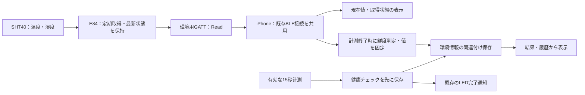

# 室温・湿度の表示と記録 実装計画書

作成日：2026年10月18日 ／ 対象：iPhone 17とPSOC™ Edge E84 AI Kitを用いたデモ

## 1. 目的・提案する体験

15秒健康チェックに「チェックした場所の環境」を添える。キットのSHT40で取得した温度・相対湿度をiPhoneに表示し、有効な健康チェックの記録に関連付けて端末内へ保存する。

画面の呼称は「キット付近の室温」「キット付近の相対湿度」とし、体温の入力欄と分ける。例えば、体調の自己申告と、そのときの環境を後から一緒に見返せる。室温・湿度から体調不良の原因を断定したり、病気・緊急性を判断したりしない。

本書は計画書作成依頼に対する実装案である。周期・鮮度・通信形式・保存形式は推奨案であり、確定仕様や実装済み機能として扱わない。今回はコード変更、キットへの書き込み、DB移行を実施しない。

## 2. 現在地と実装の前提

2026年10月18日に現在のチェックアウトと`.codex/STATE.md`を照合した。

| 項目 | 確認した状態と影響 |
| --- | --- |
| 作業場所 | `codex/e84-led-notification`。LED実装等の未コミット変更があるため保持し、計画書以外の製品ファイルは編集しない |
| iPhone | STATEではiPhone 17／iOS 27.0.1への導入と、LED連動の主要動線を実機確認済み。今回の温湿度機能の実機検証は未実施 |
| 既存BLE | `flutter_reactive_ble` 5.6.0、`LedNotificationService`、`ReactiveLedTransport`がある。接続・再接続と世代管理を再利用する |
| キット | 公式Find Me v2.3.1、元コミット`ea2a19fa2b1321525f3ae0645ae2fba4f5d64340`を採用。現在の版情報では独自ファームウェア変更はない |
| 温湿度 | SHT40読み出し・環境用GATT・画面・DB保存は、このチェックアウトに未実装 |
| DB | このブランチの`AppDatabase.schemaVersion`は4。作業中に更新されたSTATEと別worktreeを確認し、`codex/fix-startup-db-migration`ではmain `c548ef2`起点の起動移行修正、実機でのv6移行・既存記録保持・履歴表示復帰を確認済み。修正は未コミット・main未反映で、このLEDブランチにも未統合 |
| 日程 | Day2のiPhoneデモ方針は共有済み。現在フェーズ・残り時間・機能凍結までの枠は、日付から推測しない |

実装開始時は統合先のブランチ、実機に導入する版、起動移行修正の取り込み状況、残り時間を確認する。新機能の実装が凍結後に当たる場合は本書を後続計画として保持し、既存デモの安定化を優先する。環境保存の追加によって、修正前のDB移行処理を再導入しない。

## 3. MVPの範囲

### 必須

- 接続中のキットから実際のSHT40の値を受信し、現在値を表示する。
- 有効な15秒計測の終了時点で、条件を満たす環境値を1件に固定する。
- まず健康チェックを保存し、同じ記録IDへ環境情報を関連付ける。
- 結果画面・履歴から開いた結果画面で、保存した環境値・取得元・受信日時を確認できる。
- 取得不可・期限切れ・未対応でも健康チェックを続け、未測定値は`null`とする。
- 記録削除に環境情報も連動させ、既存のLED連動・自己申告・体温・レポートを維持する。

### 今回は含めない

温湿度の連続履歴、環境グラフ、最適環境の判定、健康への影響推定、環境値を使うAIレポート変更、通知、クラウド同期、バックグラウンド取得、Androidの新規検証、レーダー、キット上でのAI推論。

## 4. 全体構成と既存LEDとの共存

キットにはSHT40が搭載され、I²CでMCUと接続する［1］。Infineonにはセンサードライバーと、このキットでの読み出し手順があるが、現在使用中のFind Meに温湿度送信が実装されているわけではない［2］。キット側の独自拡張が必要となる。

IASの`1802`／`2A06`とLEDの`0`／`2`は維持し、環境情報は別の独自サービスへ追加する。IASにJSONやセンサーデータを書き込まない。

iPhone側は接続所有者を一つにする。温湿度サービスから同じキットへ別接続を張らず、既存接続のデバイス・接続世代・切断を共有する。`LedTransport`は現状IAS専用であるため、B・Cが共有接続への拡張点を決め、LED試験を維持した最小限の変更にする。ライブラリ更新や全面的なBLE再設計を同時に行わない。

環境Readの操作番号とLEDの点灯・消灯操作番号は分け、温湿度の更新がLEDのタイマーや試行を無効化しないようにする。接続世代の変更は両方を無効化する。自動LED連動がオフでも、接続と環境取得が有効なら温湿度を利用できる構成とする。

旧ファームウェアでは「LED対応、環境情報は未対応」とする。環境サービスがないだけでLED対応のキットを非対応扱いにしない。現在の広告はIAS UUIDを含まず名前で発見する構成なので、環境UUIDの広告だけにスキャンを絞って既存機器を見失わないようにする。

## 5. キット側の取得処理案

| 項目 | 推奨案 |
| --- | --- |
| センサー | 基板上のSHT40。気圧センサー内の温度を代替値にしない |
| 取得周期 | 約2秒。センサー単体→BLE併用で安定性を確認して調整 |
| 取得方法 | Infineonドライバーの高精度単発測定を出発点とする。戻り値の温度はmilli °C、湿度はmilli %RH［2］ |
| 処理場所 | BLEのReadコールバックではI²C待機をせず、タイマー／タスク側で取得して完全な1組を公開する |
| 正常条件 | 初期化・読み取り・CRC等の検査成功。採用版ドライバーのエラー伝播を確認する |
| 異常時 | 初期化中・センサーエラー・範囲外を状態として返す。サンプルのassertで停止する処理をそのまま製品動線へ持ち込まない |
| キャッシュ | 温度・湿度・状態・取得番号・取得時刻を同じスナップショットとして排他制御する。失敗後に前回値を正常として返さない |
| ヒーター | 通常取得では使用しない。ヒーター動作直後の値を環境値として採用しない |

温度の動作範囲は−40〜125°C、相対湿度は0〜100%RHとされる［3］。本案ではこの範囲外のペアは無効とし、正常範囲へ丸めて保存しない。0°Cや負の室温、0%RHは未測定と同一視しない。

基板の発熱、設置位置、直射日光、呼気、手で覆うことの影響を実機で確認する。基板上での測定値を部屋全体の代表値や校正済み温湿度計と同等とは説明しない。センサー自体の仕様精度を、この実装全体の検証済み精度として使わない。

## 6. BLE契約案：独自Read特性1個

前景での表示中に約2秒ごとに読み出す。通知購読・独自の要求応答・JSON分割は初期実装へ含めない。Readは1件ずつとし、前の処理中に次のポーリングを積まない。

ServiceとCharacteristicにはプロジェクト専用の異なる128bit UUIDを用意し、ファームウェアとDartの定数・試験に同じ値を固定する。これは今後新設する契約であり、公式に提供されたUUIDではない。実装前にB・Cで割り当てる。特性はRead専用、固定20バイト、複数バイトはlittle-endianとする案。

| オフセット | 型 | フィールド | 意味 |
| --- | --- | --- | --- |
| 0 | uint8 | version | 初版は1。未知の版は受理しない |
| 1 | uint8 | status | 0：有効、1：初期化中、2：センサーエラー、3：範囲外。その他は無効 |
| 2〜5 | uint32 | sequence | 取得試行ごとに更新。再起動でリセット可。単独で永続的な一意IDとしない |
| 6〜9 | uint32 | sampleAgeMs | キットの単調時計による取得後の経過時間。Read応答を組み立てる時点で算出 |
| 10〜13 | int32 | temperatureMilliC | 温度×1000。有効時のみ採用 |
| 14〜17 | int32 | humidityMilliPct | 相対湿度×1000。有効時のみ採用 |
| 18〜19 | uint16 | reserved | 初版は0。異なる値は未対応として扱う |

正常以外では数値・ageの領域を未定義として読み捨て、Dart側は両方の値を`null`へ変換する。数値領域の0を代替測定値として表示しない。温度・湿度の片方だけを前回値と組み合わせない。

受信時は長さ・版・状態・予約領域・数値範囲を検証する。milli単位からの換算は`/ 1000.0`で一度だけ行い、画面は小数1桁表示、保存時は受信した精度を保つ。0.1刻みの表示は精度保証ではない。

Readタイムアウトは例として2秒。タイムアウト・切断・背景化・接続先変更で取得キャッシュを無効にし、復帰時は新しい接続で取り直す。タイムアウトしたFutureの遅い完了は接続世代・操作番号で破棄する。LEDとの共通キューでは、LED指示を新しい環境Readより優先し、積み残しを作らない。既に進行中のReadを取り消せるとは仮定しない。

## 7. 鮮度とチェックへの関連付け

ライブ表示用の最新値と、チェック記録へ保存する固定値を区別する。

| 項目 | 推奨案 |
| --- | --- |
| ライブ値の期限 | 安全側の推定経過時間が5秒以下。5秒はプロダクト側の提案値 |
| 経過時間の計算 | `応答内sampleAgeMs + Read開始から受信までの時間 + 受信後の経過時間`。iPhoneの経過時間には単調時計を使用する |
| 値の固定 | `ScanSuccess`を受けた直後、同じ接続世代の最新値が有効か確認して1組に固定 |
| 固定条件 | 終了時に環境取得が有効で接続中、状態が正常、期限内。新たなBLE読取を待たない |
| 終了時の取得不可 | 理由と両値`null`を固定し、健康チェックの保存へ進む |
| 中断・失敗 | 健康記録も環境記録も新規作成しない |
| 保存の再試行 | 当初の固定値とその時点の状態を使う。後から別の環境値へ置き換えない |
| 再接続・キット再起動 | 以前の値を再利用しない。取得番号は接続世代と組み合わせて扱う |

鮮度は計測終了時点で判定する。DB再試行時に時間が経っても、終了時に有効だった値を「終了時の記録」として保持する。履歴ではライブ値のように時間経過で無効化しない。

保存した値は15秒間の平均値ではなく、終了時点で条件を満たした直近の1サンプルと説明する。接続中でも期限切れなら「未測定（更新が停止しています）」とし、直前の値を最新値のように表示しない。

## 8. 保存設計案と既存記録の保護

`HealthCheckResult.bodyTemperatureC`と`TemperatureSource`は体温専用のままにする。室温をここへ入れたり、体温の「正の数のみ」という既存検証を流用したりしない。

健康結果モデル・AI入力への変更を抑えるため、健康記録IDを主キー兼外部キーとする任意の関連テーブル`health_record_environment`を追加する案を推奨する。型・名称は実装時にB・Cで固定する。

| 保存項目案 | 内容 |
| --- | --- |
| recordId | 既存健康記録のID。1記録につき環境スナップショット1件 |
| state | available／disconnected／unsupported／stale／sensorError／readFailed／disabled等。必要な分類を契約化 |
| ambientTemperatureC、relativeHumidityPct | availableでは両方有効、その他は両方NULL |
| source | `e84_sht40`。出所を体温と分ける |
| receivedAtUtcMicros | iPhone側の受信日時。既存のマイクロ秒の単位規約に合わせる。センサーの正確な取得日時とは表示しない |
| sampleAgeAtSnapshotMs | 計測終了時に算出した推定経過時間。available時のみ保存 |
| sampleSequence、protocolVersion | 取り違えの試験と読み出し互換性のための最小メタデータ |

実装手順は次の順序とする。

1. 有効計測の終了時に、メモリ上の環境値または未取得理由を固定する。
2. 既存の`HealthRecordStore.insert(result)`を直ちに実行する。環境BLEの新規通信を待たない。
3. 健康記録の保存成功を既存LED通知・結果表示へ引き渡す。
4. 独立したエラー処理で、その記録への環境情報の関連付け保存を開始する。環境保存中／失敗は結果画面へ通知し、健康記録の保存成功と区別する。
5. 結果・履歴は健康記録と関連データを読み、保存済みスナップショットを表示する。環境値を既存AI入力・基準値計算へ自動追加しない。

環境保存には所有者を設け、結果画面への通常遷移で消失させない。成功した環境スナップショットは後からライブ値で上書きしない。環境保存だけ失敗した場合は健康記録を保持し、「チェックは保存済みです。環境情報を保存できませんでした」と示す。再試行する場合も同じ固定値を使い、健康記録を二重INSERTしない。

関連付けの直前に親記録の存在をトランザクション内で確認し、外部キーも有効にする。親が削除済みなら終了し、削除した健康記録を環境応答から再作成しない。削除と競合しても孤立行が残らないよう、`ON DELETE CASCADE`と外部キー有効化を検証する。個別削除・全件削除の両方で確認する。

旧記録に関連行がない場合は「環境情報の保存なし」と表示する。行がないことから、取得できなかった理由を推測しない。今回の環境保存失敗後にアプリが終了した場合も、再起動後は同じ扱いとし、保存成功を捏造しない。

### DB移行の着手条件

- 先に統合先へ起動移行修正が反映されているか確認する。実機は別worktreeの修正でv6へ移行済みと記録されているため、現在のLEDブランチのv4を基に新機能の移行先をv5と決めたり、そのまま実機へ再導入したりしない。
- 統合先の実スキーマと`schemaVersion`を調べ、次の未使用版で追加テーブルを作成する。既存テーブル・健康値・日時・設定を書き換えない。
- 新規DB、正常な旧DB、不整合再現DB、移行失敗時のロールバックを、個人データを含まないfixtureで検証する。Driftの公式移行手順・試験方法に合わせる［4］。
- 外部キーは各接続で有効なことを確認する。既存の`HealthRecordRepository`の入力・レポート更新で環境行が失われないことも確認する。
- DB初期化、実機記録の削除、アンインストールで移行問題を回避しない。統合前の古いアプリを、移行後の実機DBにそのまま戻せるとは考えない。

## 9. UI案と失敗時の表現

| 場所・状態 | 表示案 |
| --- | --- |
| 接続設定 | 既存のキット接続操作を共用。「環境情報を取得する」を明示的にオンにする案。LED連動オンとは分ける |
| ホーム／計測前 | 「キット付近の環境」と室温・相対湿度、更新状態を表示。接続や取得を15秒計測の開始条件にしない |
| 正常な結果 | 「チェック時のキット付近の環境」＋保存値＋取得元SHT40＋受信日時 |
| 体温との区別 | 室温・湿度の枠の外に、既存の手入力体温をそのまま表示 |
| 未接続・取得OFF | 「室温：未測定」「相対湿度：未測定」と理由 |
| 旧Find Meファームウェア | 「このキットのファームウェアは環境情報に未対応です」。LED操作は継続 |
| センサーエラー・期限切れ | 値を未測定にし、前回値で埋めない。計測の品質不良とは別の案内 |
| 環境保存中／失敗 | 保存中の状態、または健康記録と環境情報の保存結果を分けた文言 |
| 履歴から結果を開く | 当時の保存値を表示。現在の室温で過去記録を更新しない |

表示のためのサンプル値は画面開発・テストに分離し、実測デモや実測履歴へ混ぜない。Bluetooth利用説明は既存のLED向け文言を環境取得も含む内容へ更新する案とし、Bが`ios/Runner/Info.plist`を管理する。新規位置情報・背景モード・クラウド接続は追加しない。

## 10. 担当・変更範囲・工程

| 担当案 | 主な作業 |
| --- | --- |
| A | 表示文言・体温との区別、設置場所、デモ操作、手動試験 |
| B | 既存BLE接続の共用、パーサー・鮮度・スナップショット、関連DB・削除、結果／履歴UI、iOS説明 |
| C | SHT40単体取得、Find Meへのタスク・GATT追加、LEDとの同時動作、固定版と成果物の記録 |
| B・C共同 | UUID、バイト構成、単位、状態、接続世代、保存時点の契約 |

変更候補は`lib/services/device/`、環境専用モデルとRepository、`app_database.dart`と生成物、`scan_screen.dart`・結果／履歴の表示、必要なホーム／設定、`Info.plist`、`firmware/e84/`と対応テスト。`pubspec.yaml`・lockfile・`main.dart`・`ios/`はBが変更窓口。現在の依存で足りるか確認し、不要な依存更新はしない。

| 工程 | 目安 | 完了条件 |
| --- | --- | --- |
| 0. 統合・契約の確認 | 20〜30分 | 起動不具合の解消状況、残り枠、担当・保存時点・UUIDを確認 |
| 1. SHT40単体 | 30〜60分 | 実センサーから単位と状態を確認。既存の復旧用LEDファームウェアを保持 |
| 2. Find Me拡張 | 60〜120分 | 温湿度Readと既存IASが1接続で動く。センサー異常でもBLE／LEDが停止しない |
| 3. iPhone表示 | 45〜90分 | 検証・鮮度・切断処理と実際の現在値を確認 |
| 4. DB・結果／履歴 | 60〜120分 | 非破壊移行、固定値の保存・再表示・削除が成立 |
| 5. 回帰・デモ | 45〜60分 | 次節の必須試験と既存LED動線を確認 |

合計は約4.5〜8時間。起動不具合の修正、環境導入、統合衝突の解消は別枠。既存BLEがあるため接続の土台は使えるが、LED操作だけより変更範囲が広い。

工程2が通るまでは実測保存へ結合しない。時間不足なら「ライブ表示まで」「表示と保存まで」を区別し、ライブ表示だけを記録機能の完成とは報告しない。Day2開始5時間後の新機能凍結と最後の2時間のデモ確認を優先する。

## 11. 試験・受け入れ基準

すべて実施予定であり、今回の作業では未実施。モックで確認するロジックと、実機が必要な取得・通信・表示を区別する。

| ID | 試験 | 合格条件 |
| --- | --- | --- |
| E01 | SHT40実取得 | 実際の値がiPhoneへ届き、milli単位を正しく換算。UART確認値との対応が取れる |
| E02 | パケット検証 | 20バイト以外、未知版・状態・予約値、範囲外を受理しない。0°C・負の室温・0%RHを有効値として扱える |
| E03 | 鮮度境界 | 5秒境界、長いRead、更新停止、端末時刻変更を試し、古い値を最新として保存しない |
| E04 | 再接続・リセット | キャッシュを破棄し、古いRead応答や同じ取得番号が新しい接続へ混入しない |
| E05 | 正常保存 | 有効計測終了時の値と状態を固定。履歴から開いても同じ値・取得元・受信日時を表示 |
| E06 | 任意機能の失敗 | 未接続、OFF、旧ファームウェア、センサーエラー、BLE拒否でも健康チェックを保存でき、環境値はNULL |
| E07 | 保存失敗・再試行 | 健康保存失敗では環境行を作らない。環境保存だけ失敗しても健康結果を失わず、同じ固定値で再試行 |
| E08 | 中断・競合 | 顔外れ・取消・背景化では不要な環境記録を作らず、正常な結果遷移では関連付け処理を失わない |
| E09 | 削除と更新 | 個別／全件削除で関連行が消える。遅い書き込みで削除済み記録を復活させず、自己申告・AI追記で環境情報を消さない |
| E10 | DB移行 | 新規・旧版・不整合再現・ロールバックを確認。健康値、NULL、日時、説明確認、既存設定を保持 |
| E11 | LED回帰 | 同一接続で環境取得と完了LEDが動き、保存前点灯・二重点灯・消灯遅延・接続競合を起こさない |
| E12 | オフライン反復 | Wi-Fi・モバイル通信OFF、Bluetooth ONで2回以上、実取得→15秒→保存→再表示→LED連動が通る |

パーサー、鮮度、固定時点、保存・削除競合はDart／DBテストで検証する。既存手順の`dart format --output=none --set-exit-if-changed lib test`、`flutter analyze`、`flutter test`と、iOS・ファームウェアのビルドを実施する。取得・無線・設置影響はiPhone／キット実機で確認し、ビルド成功だけで合格にしない。

センサーの設置後の安定時間と、近くに置いた参考温湿度計との差・変動傾向も調べる。ただし参考機器との一致だけで医療・校正精度を主張しない。デモで値を変えるために呼気を当てたり手で覆ったりせず、液体・高温源を使わない。

## 12. デモと引き継ぎ

1. 統合先のiPhoneアプリが既存記録を保持して正常起動することを確認する。
2. キットを給電して安定した場所へ置き、他のBLEテストアプリを切断する。
3. 対象キットへ接続し、環境取得をオンにする。更新中の実値と「キット付近」の表記を示す。
4. 通常の顔位置確認・15秒計測を実施する。保存完了のLEDと、結果画面の環境保存を確認する。
5. 履歴から同じ記録を開き、当時の値が保存されていることを示す。
6. キット切断後でも通常の健康チェックができ、その記録の環境情報が未測定となることを示す。

成果物は、環境対応ファームウェアの差分・固定依存・ハッシュと復旧手順、iPhoneアプリ、非破壊DB移行、E01〜E12の結果、デモ手順。温湿度の実機記録や健康値をGit・試験fixture・公開ログへ含めない。進捗・実機条件・未確認事項は`.codex/STATE.md`へ更新する。

## 13. 参照資料

公式資料の確認日：2026年10月18日。キット搭載やドライバー単体の対応と、今回の統合機能の動作保証を区別する。

1. [Infineon：KIT_PSE84_AIガイド](https://documentation.infineon.com/psocedge/docs/cci1762693051052) — SHT40搭載とI²C接続。
2. [Infineon：SHT4xドライバー](https://github.com/Infineon/sensor-humidity-sht4x)、[API文書](https://github.com/Infineon/sensor-humidity-sht4x/blob/master/api_reference.md) — キット向け読み出し例、単発取得、milli単位。実装時に版を固定する。
3. [Sensirion：SHT40仕様](https://sensirion.com/jp/products/catalog/SHT40)、[SHT4xデータシート](https://sensirion.com/media/documents/33FD6951/67EB9032/HT_DS_Datasheet_SHT4x_5.pdf) — 動作範囲と取得上の制約。
4. [Drift：Migrations](https://drift.simonbinder.eu/migrations/) — DB移行・検証の公式手順。
5. 既存実装・版情報：`lib/services/device/`、`lib/screens/scan_screen.dart`、`lib/services/db/`、`firmware/e84/findme-source.json`、`firmware/e84/build-manifest.json`、`docs/e84-led-demo.md`。
6. 仕様正本：`docs/app-spec-source.txt`、`docs/team-plan-source.txt`、共有契約：`docs/implementation-decisions.md`。
