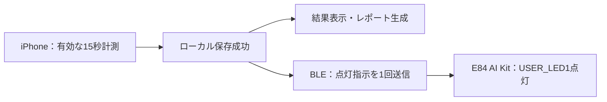

# iPhoneの計測完了に連動するLED通知 実装計画書

作成日：2026年10月17日 ／ 対象：ハッカソンDay1〜Day2のデモ

## 1. 目的と位置付け

iPhoneで有効な15秒計測が終わり、結果をローカル保存できたことを、PSOC™ Edge E84 AI KitのLEDで知らせる。スマートフォンと外部デバイスが連動する体験を、既存の計測機能への変更を抑えて追加する。

ユーザーから依頼されたのは計画書の作成であり、本書は実装案である。点灯条件・消灯時間等は以下の推奨案を示し、既存仕様の確定事項と区別する。実装時にB・Cで既存の計測・保存契約へ対応付ける。

- デモ対象：iPhone実機1台と`KIT_PSE84_AI`実機1台。
- 成功の見せ方：「顔位置確認 → 15秒計測 → 保存成功 → キットのLED点灯」。
- LEDの意味：計測記録の保存完了。健康状態の正常・異常を示さない。
- 今回はBLEによる機器連携。キット上のAI推論を使用したとは説明しない。
- 温湿度取得、レーダー、音声操作、Androidの新規対応、バックグラウンド通信は本計画に含めない。

## 2. 現在地と実装前の確認

ユーザー申告では当初の機能はほぼ実装済みで、現在はDay1、Day2はiPhoneでデモを行う。一方、本書作成時に参照したチェックアウトには仕様書と配置用フォルダーのみがあり、Flutterの`pubspec.yaml`、アプリ実装、キット用ファームウェアは見つからなかった。そのため以下のファイル名・APIは新設候補であり、実装済みとは扱わない。

| 確認項目 | 担当案 | 着手時に残す情報 |
| --- | --- | --- |
| 実装済みアプリの場所と作業ブランチ | B | リポジトリ／ブランチ、既存の実機ビルド手順 |
| デモ用iPhone | B | 機種、iOS、署名・インストールの可否 |
| キットと開発環境 | C | 基板リビジョン、ModusToolbox・BSP・コンパイラーの版 |
| 基にする公式サンプル | C | 使用したリリースまたはコミット、ビルド設定 |
| 計測・保存の接続点 | B・C | 有効計測の判定、保存成功イベント、再試行の識別方法 |

既存の顔・品質判定の閾値や15秒を管理する時計は変更しない。実装済みアプリがある場所を確認してから差分を加え、ここでアプリ全体を作り直さない。

## 3. 最小構成と技術的な根拠

保存成功を起点に、通常の結果表示とLED通知を分ける。AI生成やBLE送信の完了を、保存成功の条件にしない。

| 要素 | 採用案・確認できたこと |
| --- | --- |
| キット側 | Infineon公式のBLE Find Meサンプルを使用。`KIT_PSE84_AI`への対応が明記されている［1］ |
| iPhone側 | BLEのCentral／GATTクライアントとして接続する |
| 初回の疎通確認 | iPhoneのAIROC Bluetooth ConnectでキットのLEDを操作する［1］ |
| Flutterライブラリ | 既存のBLE実装を優先。未導入なら`flutter_reactive_ble`を候補とし、アプリのSDK・iOS条件との適合を確認する［2］ |
| 給電 | 開発中はKitProg3 USB接続を使用。デモ時の給電方法とケーブルを実機で確認する |

公式サンプルのREADMEでは、ModusToolbox 3.7以降、BSP 1.0.0以上が要件となっている。また、未接続時の広告は120秒で停止する。対象を`KIT_PSE84_AI`に明示し、デモ直前の起動・接続手順を決める［1］。

## 4. BLE通信契約案

独自GATTサービスを新設せず、Find Meが使うImmediate Alert Service（IAS）を再利用する。UUIDはBluetooth SIGの定義［3］、値はGATT Specification Supplement［4］に基づく。以下の書き込み方式はIAS仕様［5］に従う。

| 項目 | 値 |
| --- | --- |
| Service | Immediate Alert Service：`0x1802` |
| Serviceの128bit表現 | `00001802-0000-1000-8000-00805f9b34fb` |
| Characteristic | Alert Level：`0x2A06` |
| Characteristicの128bit表現 | `00002a06-0000-1000-8000-00805f9b34fb` |
| 書き込み | Write Without Response。接続後にサービス・特性・プロパティを検証する |
| 消灯 | 1バイトの`[0x00]`（No Alert） |
| 点灯 | 1バイトの`[0x02]`（High Alert） |
| 未使用 | `[0x01]`（Mild Alert）。今回の完了通知では点滅を使わない |

公式サンプルではNo AlertはUSER_LED1消灯、High Alertは点灯に対応する［1］。プロトコル上の「High Alert」は強い通知の指定であり、アプリの健康上の緊急判定ではない。

送信するのは上記の操作値だけとし、顔画像、計測値、記録ID、履歴、レポート本文は送らない。

IASには点灯完了を読み戻す機能やアプリ向けの確認通知がない［5］。Flutterの書き込み処理が戻っても、LEDの実点灯を確認したとは扱わない。UIは「点灯指示を送信しました」とし、実点灯は実機試験で確認する。確認応答のためだけに独自プロトコルを増やさない。

## 5. 点灯・消灯と失敗時の挙動案

### 5.1 点灯条件

次の条件をすべて満たした場合だけ、点灯指示を送る。

1. 既存の計測処理が、顔位置確認後の15秒計測を有効として完了した。
2. その結果のローカル保存が成功した。
3. アプリがフォアグラウンドにあり、現在の試行が中断・破棄されていない。
4. 選択したキットに接続済みで、対象のGATT特性を検証できている。
5. その試行に対する点灯送信をまだ開始していない。

自己申告の追記、レポート生成完了、結果画面の再表示、履歴閲覧、アプリ再起動では再点灯しない。保存失敗・品質不良・顔外れ・アプリ離脱・キャンセルでは点灯しない。

### 5.2 消灯と次回計測

- 接続準備完了時と次の計測準備時に、消灯指示を送る。
- 点灯指示から約3秒後に、同じ接続に対して消灯指示を1回送る。3秒はデモ向けの提案値で、実機で視認性を確認する。
- LED用タイマーは計測の15秒タイマーから分離し、計測終了を管理しない。
- 古い消灯タイマーを次の試行へ持ち越さない。接続世代と試行を識別し、新しい点灯を古い処理で消さない。
- 切断・アプリのバックグラウンド移行・チェックのキャンセル時にはタイマーと未送信処理を破棄する。可能な場合は消灯を試みるが、キットの実状態は未確認として扱う。
- 正常終了による撮影画面から結果画面への遷移では、点灯・消灯処理を破棄しない。通知処理の所有者は撮影画面より長く生存する統合サービスとし、通常の画面遷移と計測中断を区別する。
- スマートフォンからの消灯が届かない場合に備え、デモ前に物理的な消灯を確認する。切断時の消灯・再広告は実機で試験する。必要ならキット側の自動消灯を追加候補とするが、最初から必須にしない。

### 5.3 通信失敗

| 状況 | 計測・保存 | LED／接続表示 |
| --- | --- | --- |
| キット未接続・電源OFF | 通常どおり続行 | 「キット未接続」 |
| Bluetooth OFF・権限拒否 | 通常どおり続行 | 理由と再接続導線を表示 |
| 接続中・対象サービスなし | 通常どおり続行 | 接続準備中／非対応として表示 |
| 計測中にBLEだけ切断 | カメラ計測を続行。顔外れ等の中断とは区別 | 完了時に未接続なら送信しない |
| 保存失敗 | 既存の保存エラーを表示 | 点灯しない |
| 点灯送信時の例外・待ち時間超過 | 保存した結果を保持し、結果画面を止めない | 「点灯指示を送信できませんでした」 |
| AI生成失敗 | 既存の定型レポートへ切替え | 保存・計測が成功していればLED通知の対象 |
| 再接続 | 記録を再作成しない | 過去の点灯指示を再送しない |

送信は試行ごとに最大1回とし、自動再送・永続キューは設けない。受信確認がないため、エラー時でも既に点灯している可能性がある。送信開始前に試行を処理済みとして記録し、二重コールバックを防ぐ。

送信処理には短い上限時間を設ける案（例：2秒）とする。ただし、Futureのタイムアウトだけでは内部の送信が止まるとは限らない。未開始の命令は破棄し、投入済みの命令は取り消せない前提で、接続世代・試行の確認と後続操作の直列化を行う。タイムアウトを理由に自動再送しない。

## 6. iPhone側の変更範囲と担当案

| 担当 | 作業と成果物 |
| --- | --- |
| A | 接続・送信失敗の文言、LEDの視認性、デモ手順、手動試験 |
| B | BLE依存・iOS設定・接続UI・保存成功後の呼び出し・非同期処理・iPhoneビルド |
| C（追加担当案） | キットのサンプル取得・ビルド・書き込み・実機LED試験。P0作業と衝突する場合は着手前に担当を調整 |
| B・C共同 | 有効計測と保存成功の接続点、失敗分類、通信契約の照合 |

変更先の候補は`lib/services/device/`のBLEサービス、既存の保存を取りまとめる処理、接続状態を表示する既存画面、`pubspec.yaml`・lockfile、iOSの`Info.plist`。既存構成が異なる場合は対応する責務へ読み替える。BLE通知のためにDB形式や健康結果の共通型を変更しない。

`pubspec.yaml`・lockfile・`ios/`はBが変更窓口となる。iOSのBluetooth利用説明には`NSBluetoothAlwaysUsageDescription`を追加する［6］。文言案：「チェック完了を外部キットのLEDでお知らせするため、Bluetoothを使用します。」

アプリ内で接続先を選び、接続状態と送信状態を分けて表示する。同名デバイスが複数ある場合は自動選択しない。接続後にIASを確認し、初回はLEDテストで対象の実物を特定する。名前だけを認証として扱わない。

新規の位置情報権限、バックグラウンドモード、クラウドサービスはこの機能のために追加しない。スキャン・接続の購読は所有者を一つにし、完了・切断・離脱時に不要な処理を終了する。

## 7. 実装順序と時間配分

各時間は着手後の作業枠の目安であり、完了保証ではない。現在時刻からDay1の残り時間を推測せず、チームの残り枠に合わせる。Day1のP0通し動作を優先する。

| 工程 | 目安 | 完了条件 |
| --- | --- | --- |
| 0. 実装場所・契約確認 | 15〜30分 | アプリの場所、担当、保存成功の接続点を確認 |
| 1. 公式サンプル単体 | 30〜60分 | `KIT_PSE84_AI`向けに書き込み、iPhoneのAIROCアプリで消灯・点灯を確認 |
| 2. Flutterから手動操作 | 45〜90分 | 自分たちのアプリで接続・消灯・点灯できる。操作試験を実測履歴に残さない |
| 3. 有効計測・保存へ接続 | 30〜60分 | 有効な結果の保存後に1回だけ送信。結果表示・AI処理を待たせない |
| 4. 失敗・反復試験 | 30〜60分 | 次節の必須項目を実機で確認 |

全体の目安は約2.5〜5時間。署名やツール導入、ダウンロード、既存不具合の解消は別途必要になり得る。

工程1の最初の枠で疎通できなければ、ビルド・書き込み・広告・iPhone接続のどこで失敗したかを切り分けて共有し、P0を圧迫する場合は追加作業を止める。工程2が動くまでは、本体の計測処理へ結合しない。

Day2開始5時間後に新機能を凍結し、最後の2時間にオフラインのデモを最低2回行う。連動を完成できなかった場合は、通常のiPhoneデモを優先する。AIROCアプリからの手動点灯は機器単体の動作確認として区別し、「計測完了と連動した」と説明しない。

## 8. 試験と受け入れ基準

以下は実施予定であり、本書作成時点では未実施。LEDの実点灯・消灯はiPhoneとキットの実機で確認し、シミュレーターやモックだけで合格にしない。

| ID | 試験 | 合格条件 |
| --- | --- | --- |
| L01 | 通常の有効計測 | 15秒終了・保存成功より前は完了LEDが点かず、保存後に点灯し、その後消灯する |
| L02 | 顔未検出・光量不足 | 計測を開始せず、点灯指示を送らない |
| L03 | 途中の顔外れ・キャンセル・アプリ離脱 | 無効／中断となり、遅れて完了LEDを点けない |
| L04 | 保存失敗 | 保存エラーを表示し、点灯指示を送らない |
| L05 | キットOFF・未接続 | 通常の計測・保存・結果表示が完了し、未接続を正しく表示 |
| L06 | Bluetooth OFF・権限拒否 | クラッシュせず案内し、健康チェックを続けられる |
| L07 | 計測中／点灯直前の切断 | 保存結果を失わず、LED送信失敗を計測失敗と混同しない |
| L08 | 送信例外・タイムアウト | 結果画面が止まらず、再送しない。遅い応答が次の試行を上書きしない |
| L09 | 二重完了通知・画面再表示・自己申告追記 | 同じ試行への点灯送信が最大1回 |
| L10 | AI失敗・生成遅延 | 保存成功後にLED指示を送り、AIを待たずに通常のフォールバックが成立 |
| L11 | 再接続・再計測・キット再起動 | 古い指示を再送しない。古い消灯タイマーが新しい点灯を消さない。再接続手順が再現可能 |
| L12 | オフライン通し試験 | 機内モード後にBluetoothを有効化し、Wi-Fi・モバイル通信OFFで最低2回通る |

保存前送信、失敗時の誤点灯、二重送信、古い非同期処理の混入はDart側のテストで検証する。既存リポジトリの手順を優先し、存在する対象に対して`dart format --output=none --set-exit-if-changed lib test`、`flutter analyze`、`flutter test`を実行する。iOSビルドとキットのビルドも実施する。ログに健康情報を残さない。

記録欄：iPhone機種／iOS、基板リビジョン、アプリ・ファームウェアの版、ツールの版、各試験の合否・再現条件。保存完了から実点灯までの遅延も確認し、デモ上の目標を1秒以内として実測する（性能保証ではない）。

必須の合格条件はL01〜L12と既存のP0フローの維持。LEDが光ったことをソフトウェアだけで保証する機能は今回の完了条件に含めない。

## 9. デモ手順と成果物

1. キットの給電、iPhoneのBluetooth、アプリ起動を確認する。
2. AIROC等のテストアプリから切断し、自分たちのアプリで対象キットへ接続する。広告停止時は確認済みの再広告／リセット手順を使う。
3. 接続・LEDテストを行い、消灯を目視確認する。試験操作を計測完了として表示・保存しない。
4. 通常の顔位置確認と15秒計測を行う。
5. 保存された結果とLED点灯を示し、「記録の保存完了を外部キットで通知しています」と説明する。
6. 自動消灯を確認する。必要なら結果・履歴へ進み、再点灯しないことを示す。

成果物は、iPhoneへ導入できるアプリ、版を特定できるキット用ファームウェア／ビルド手順、L01〜L12の試験結果、再接続を含むデモ手順。実装時の現在地と試験結果は`.codex/STATE.md`に更新する。

## 10. 参照資料

公式情報の確認日：2026年10月17日。記載内容は文書上の対応であり、手元の実機での成功を示すものではない。

1. [Infineon：PSOC Edge BLE Find Meサンプル](https://github.com/Infineon/mtb-example-psoc-edge-btstack-findme) — 対応キット、ツール要件、iOSでの試験、LED動作、広告時間。
2. [flutter_reactive_ble：パッケージ提供元の文書](https://pub.dev/packages/flutter_reactive_ble) — iOS対応、スキャン・接続・書き込み、iOS設定。採用版は実装時に固定する。
3. [Bluetooth SIG：Bluetooth LE Primer](https://www.bluetooth.com/wp-content/uploads/2022/05/Bluetooth_LE_Primer_Paper.pdf) — IASとAlert LevelのUUID。
4. [Bluetooth SIG：GATT Specification Supplement](https://btprodspecificationrefs.blob.core.windows.net/gatt-specification-supplement/GATT_Specification_Supplement.pdf) — Alert Levelの1バイト値。
5. [Bluetooth SIG：Immediate Alert Service仕様](https://www.bluetooth.com/wp-content/uploads/Files/Specification/HTML/IAS_v1.0/out/en/index-en.html) — Write Without Response、Read／Notify等を提供しない特性、アラートの終了条件。
6. [Apple：NSBluetoothAlwaysUsageDescription](https://developer.apple.com/documentation/BundleResources/Information-Property-List/NSBluetoothAlwaysUsageDescription) — Bluetooth利用理由の設定。
7. リポジトリ内の正本：`docs/app-spec-source.txt`（基本原則・例外動作・保存）、`docs/team-plan-source.txt`（担当・Day2凍結・試験）。
